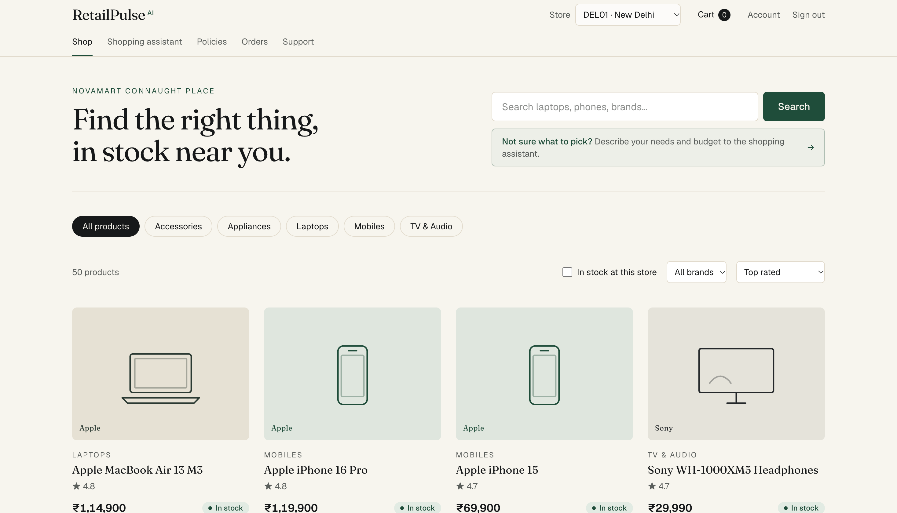
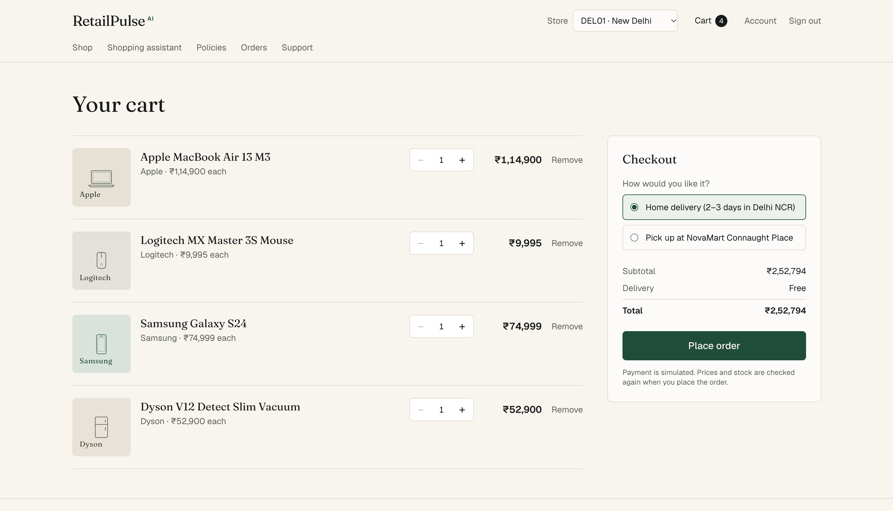
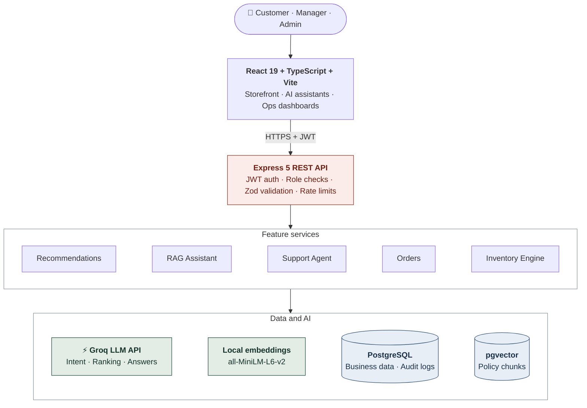
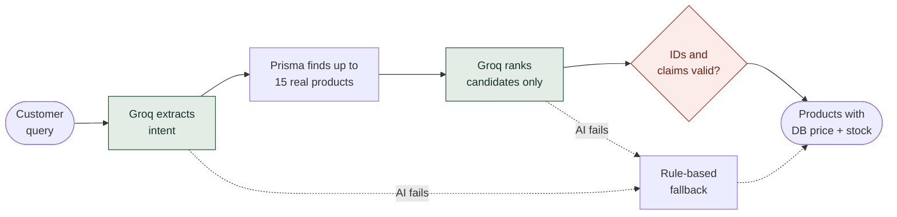
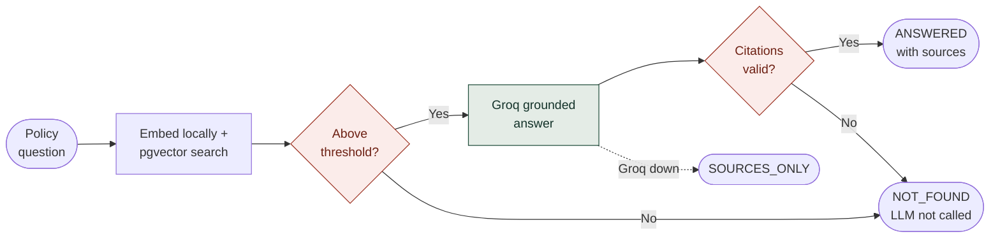
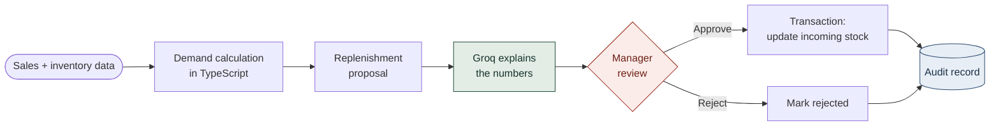
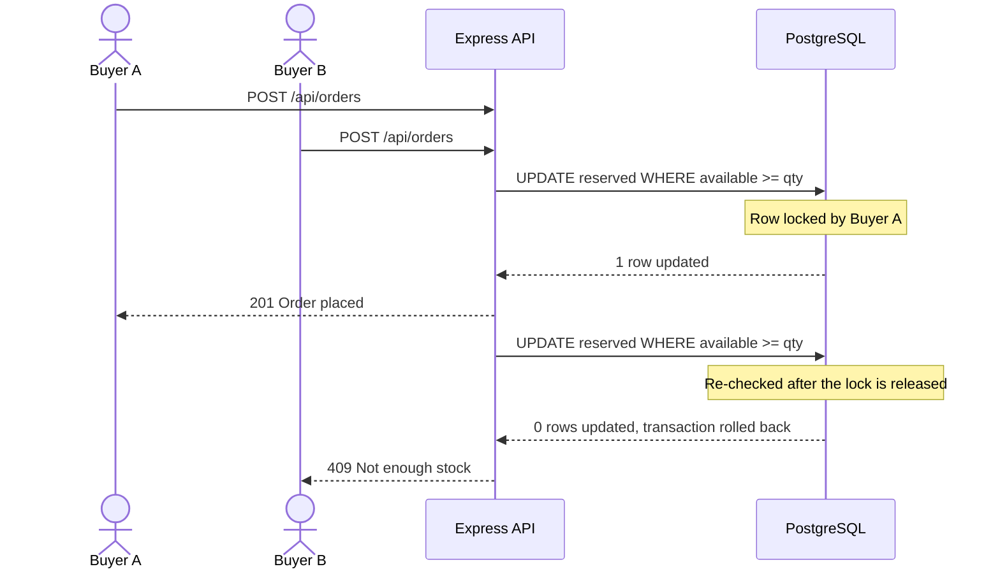
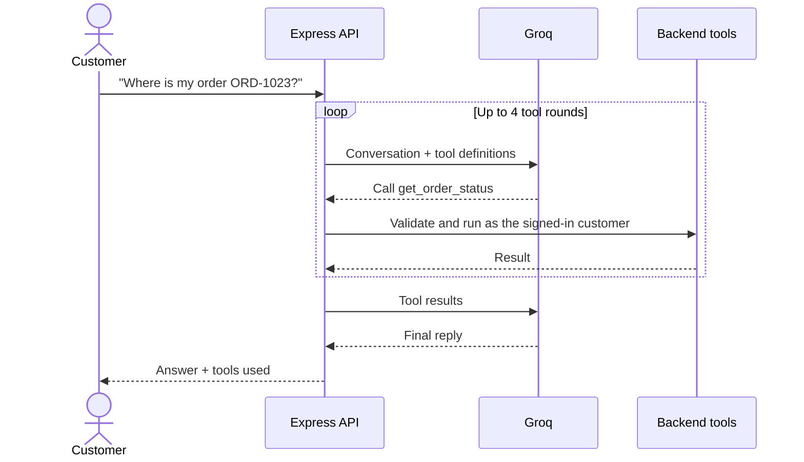

<div align="center">

# 🛍️ RetailPulse AI

### AI-Powered Retail Intelligence Platform

**Intelligent Retail. Grounded AI. Controlled Operations.**

[](https://retailpulse-ykxb.onrender.com)


[Features](#features) · [Architecture](#architecture) · [Workflows](#workflows) · [Getting Started](#getting-started) · [API](#api) · [Testing](#testing)

</div>

---

RetailPulse AI is a full-stack retail platform built for **NovaMart**, a fictional retailer. It combines AI-powered product discovery, RAG-based policy assistance, intelligent customer support, and inventory optimization.

The platform integrates LLMs with real database operations, deterministic business logic, and human-in-the-loop approval workflows to deliver reliable AI-assisted retail operations.

> **Core principle:** AI assists decision-making; application logic controls execution. The database remains the source of truth, and managers approve inventory changes.

**Focus areas:** Full-Stack Development · Generative AI · RAG · Backend Engineering · Database Transactions · API Security

<a id="features"></a>

## ✨ Key Features

<table>
<tr>
<td width="50%" valign="top">

### 🛒 Intelligent Shopping

- Product discovery with category, brand, price, rating, and availability filters
- AI shopping assistant that understands natural-language requirements and recommends from the actual catalogue
- Personalized preferences: budget, favourite brands, and preferred store
- Store-level availability and alternative store suggestions
- Membership tiers earned automatically from 12-month spend

</td>
<td width="50%" valign="top">

### 🧠 AI-Powered Customer Experience

- **RAG Policy Assistant:** semantic search over policy documents with PostgreSQL and pgvector
- **Grounded Responses:** AI answers with validated source citations
- **Tool-Calling Support Agent:** checks orders, searches policies, and creates tickets through controlled backend tools
- **Graceful Fallbacks:** rule-based recommendations and source-only policy responses when AI services fail

</td>
</tr>
<tr>
<td width="50%" valign="top">

### 📦 Inventory Intelligence

- Inventory health dashboard with stock levels, demand, and days of cover
- Deterministic demand-based replenishment calculations
- AI-generated explanations for replenishment proposals
- Human-approved inventory actions
- Transaction-safe approvals and audit logging

</td>
<td width="50%" valign="top">

### 🔐 Security & Reliability

- JWT authentication and database-backed role authorization
- Password hashing using bcrypt
- Runtime request validation using Zod
- Atomic stock reservation during checkout
- Rate limiting and audit logging
- Admin console for site settings and user roles

</td>
</tr>
</table>

<!--
## 🖥️ Screenshots

Save genuine screenshots from the running app in docs/screenshots/ with these names, then remove this comment's markers.

| Customer Storefront | AI Shopping Assistant |
| :---: | :---: |
|  |  |
| **Policy Assistant** | **Inventory Dashboard** |
|  |  |
-->

<a id="architecture"></a>

## 🏗️ Architecture



### Core Components

| Component | Responsibility |
| :--- | :--- |
| **React Frontend** | Storefront, AI assistants, orders, and manager dashboards |
| **Express Backend** | REST APIs, authentication, validation, and business logic |
| **PostgreSQL** | Users, products, inventory, orders, and application data |
| **pgvector** | Semantic retrieval of policy documents |
| **Local Embeddings** | Converts policy sections and queries into vectors |
| **Groq** | Intent extraction, product ranking, and AI responses |
| **Inventory Engine** | Deterministic stock and replenishment calculations |

<a id="workflows"></a>

## 🔄 Important Workflows

### 1. AI Product Recommendations



- Groq extracts budget, category, brands, and requirements.
- Prisma retrieves up to 15 actual products.
- The model ranks only retrieved candidates.
- Invalid product IDs are dropped, and reasons with unsupported numbers are replaced from the product data.
- Rule-based ranking provides fallback recommendations.

### 2. RAG Policy Assistant



- Uses local `all-MiniLM-L6-v2` embeddings (384 dimensions).
- Stores vectors in PostgreSQL using pgvector.
- Filters results by the authenticated user's region, membership tier, and effective date.
- Excludes chunks below the configured similarity threshold.
- Returns `NOT_FOUND` when evidence is insufficient.
- Returns `SOURCES_ONLY` when retrieval succeeds but Groq is unavailable.

### 3. Human-Approved Inventory



- Demand and reorder quantities are calculated using deterministic TypeScript logic.
- Groq only generates explanations.
- Inventory scans create proposals, never automatic stock updates.
- Conditional updates and transactions prevent duplicate approvals.

### 4. Checkout: Two Buyers, One Unit Left



### 5. Support Agent Tool Loop



## 🧰 Tech Stack

| Layer | Technologies |
| :--- | :--- |
| **Frontend** | React 19, TypeScript, Vite |
| **Styling** | Tailwind CSS 4 |
| **Routing & State** | React Router, Zustand |
| **API Client** | Axios |
| **Backend** | Node.js, Express 5, TypeScript |
| **Validation** | Zod |
| **ORM** | Prisma 7 |
| **Database** | PostgreSQL 16, pgvector |
| **AI** | Groq API |
| **Embeddings** | all-MiniLM-L6-v2 |
| **Authentication** | JWT, bcrypt |
| **Testing** | Vitest, Supertest |
| **Infrastructure** | Docker, Docker Compose |
| **Deployment** | Docker, Render, Neon PostgreSQL |

<a id="getting-started"></a>

## 🚀 Getting Started

### Prerequisites

- Node.js 22.22+
- npm
- Docker Desktop
- Groq API key for AI functionality

### 1. Clone the repository

```bash
git clone https://github.com/Muditgolaa/RetailPulse.git
cd RetailPulse
```

### 2. Start the database

```bash
docker compose up -d
```

### 3. Configure the environment

```bash
cp backend/.env.example backend/.env
```

Set these variables in `backend/.env`:

```env
SEED_DEMO_PASSWORD=your_demo_password
JWT_SECRET=your_secure_random_secret
DEMO_LOGIN_ENABLED=true
ADMIN_EMAILS=your_email@example.com
GROQ_API_KEY=your_groq_api_key
```

Generate a secure JWT secret:

```bash
openssl rand -hex 32
```

### 4. Install dependencies

```bash
cd backend && npm install
cd ../frontend && npm install
```

### 5. Initialize the database

From `backend/`:

```bash
npm run db:deploy
npm run db:seed
npm run db:verify
npm run kb:ingest
```

### 6. Run the application

```bash
# Terminal 1: backend (http://localhost:4000)
cd backend && npm run dev

# Terminal 2: frontend (http://localhost:5173)
cd frontend && npm run dev
```

Open **http://localhost:5173**.

## 👤 Demo Accounts

All demo data is fictional. The password is the value configured in `SEED_DEMO_PASSWORD`.

| Email | Role | Tier |
| :--- | :--- | :--- |
| `priya@novamart.test` | CUSTOMER | GOLD |
| `arjun@novamart.test` | CUSTOMER | STANDARD |
| `rahul@novamart.test` | MANAGER | — |

The seed includes four Delhi NCR stores, 50 products, 14 days of sales history, low-stock scenarios, and a delayed order.

One-click demo access is controlled by application settings. Enable it only when using fictional demo data.

## 🎬 Interview Demo Flow

| Step | Feature | Demonstration |
| :---: | :--- | :--- |
| 1 | Authentication | Login as Priya |
| 2 | Storefront | Search and filter products |
| 3 | AI Shopping | Get natural-language recommendations |
| 4 | RAG Assistant | Ask a policy question and inspect citations |
| 5 | Support Agent | Check order status and create a ticket |
| 6 | Inventory | Login as Rahul and inspect stock health |
| 7 | Replenishment | Generate inventory proposals |
| 8 | Approval | Approve or reject a proposal |
| 9 | Audit | Inspect the recorded decision |

## ⚙️ Key Engineering Decisions

| Decision | Implementation | Engineering Concept |
| :--- | :--- | :--- |
| Database as source of truth | Prices and stock fetched from PostgreSQL | Data consistency |
| Runtime validation | Zod schemas | API reliability |
| Role authorization | Database-backed role resolution | Backend security |
| Atomic stock reservation | Conditional SQL updates | Concurrency handling |
| Transaction-safe approvals | Conditional state updates inside transactions | ACID transactions |
| Grounded AI responses | pgvector retrieval and citation validation | RAG |
| Controlled AI execution | Restricted backend tool calling | AI security |
| Deterministic replenishment | TypeScript business logic | Predictability |
| Fallback mechanisms | Rule-based recommendations | Fault tolerance |
| Audit logging | Recorded business decisions | Traceability |

## 📦 Important Backend Implementations

### Order Management

- Prices and customer identity are resolved by the backend.
- Stock is reserved atomically.
- Insufficient stock causes the entire transaction to roll back.
- Order cancellation releases reserved stock when permitted.
- Payment is simulated; no real payment gateway is integrated.

### Inventory Calculations

Implemented in [`backend/src/inventory/calculator.ts`](backend/src/inventory/calculator.ts).

```text
Available          = onHand - reserved
Inventory Position = available + incomingQty
Days of Cover      = available / demand
Target Coverage    = leadTime + 7-day review period
Reorder Quantity   = ceil(demand × targetCoverage) + safetyStock - inventoryPosition
```

| Severity | Condition |
| :--- | :--- |
| 🔴 **CRITICAL** | Days of cover < lead time |
| 🟡 **LOW** | Inventory position ≤ reorder point |
| 🟢 **OK** | Inventory position > reorder point |

### Support Agent

Implemented in [`backend/src/support/`](backend/src/support/).

Available tools: `get_order_status()`, `list_my_orders()`, `search_policy()`, `create_ticket()`.

The model selects tools, but backend code validates and executes them under the authenticated customer's permissions. The tool-calling loop is limited to four rounds.

### Membership Tiers

Implemented in [`backend/src/users/membership.ts`](backend/src/users/membership.ts).

| Tier | Spend in the last 12 months |
| :--- | :--- |
| Standard | Free to join |
| Silver | ₹25,000+ |
| Gold | ₹75,000+ |
| Platinum | ₹2,00,000+ |

An order that crosses a threshold upgrades the customer in the same transaction. Cancelled orders don't count, and tiers are never lowered automatically.

<a id="api"></a>

## 🔌 API Overview

| Method | Endpoint | Access | Function |
| :--- | :--- | :--- | :--- |
| `POST` | `/api/auth/login` | Public | Login |
| `POST` | `/api/auth/register` | Public | Register |
| `GET` | `/api/auth/me` | Signed in | Current user |
| `GET` | `/api/products` | Public | Product search |
| `GET` | `/api/products/:id` | Public | Product details |
| `GET` | `/api/me/membership` | Signed in | Tier, spend, and benefits |
| `POST` | `/api/ai/ask` | Signed in | Policy assistant |
| `POST` | `/api/ai/recommend` | Signed in | AI recommendations |
| `POST` | `/api/orders` | Customer | Place order |
| `GET` | `/api/orders` | Customer | Order history |
| `POST` | `/api/support/chat` | Customer | Support agent |
| `POST` | `/api/support/tickets` | Customer | Create ticket |
| `GET` | `/api/ops/dashboard` | Manager | Inventory dashboard |
| `POST` | `/api/ops/scan` | Manager | Generate proposals |
| `POST` | `/api/ops/actions/:id/approve` | Manager | Approve proposal |
| `POST` | `/api/ops/actions/:id/reject` | Manager | Reject proposal |
| `GET` | `/api/ops/audit` | Manager | Audit history |

<a id="testing"></a>

## 🧪 Testing

The project uses **Vitest** and **Supertest**: 189 backend tests in 14 files.

```bash
# Backend tests and type checking
cd backend
npm test
npm run typecheck

# Frontend type checking and build
cd frontend
npm run typecheck
npm run build
```

| Command | Purpose |
| :--- | :--- |
| `npm run db:check` | Verify PostgreSQL and pgvector |
| `npm run kb:eval` | Evaluate RAG retrieval |
| `npm run ai:check` | Verify Groq configuration |
| `npm run build` | Build backend |
| `npm start` | Start production server |

> API integration tests require PostgreSQL to be running and seeded.

## ☁️ Deployment

The application deploys as a single Docker image.

- **Application:** Docker + Render
- **Database:** Neon PostgreSQL with pgvector
- **Backend:** Express serves the API and built frontend from the same origin
- **Migrations:** Prisma `migrate deploy` during production startup

See [DEPLOYMENT.md](DEPLOYMENT.md) for deployment instructions.

## 📁 Project Structure

```text
RetailPulse/
├── backend/
│   ├── prisma/
│   ├── knowledge/
│   ├── src/
│   │   ├── auth/
│   │   ├── routes/
│   │   ├── orders/
│   │   ├── users/
│   │   ├── recommend/
│   │   ├── rag/
│   │   ├── support/
│   │   ├── inventory/
│   │   ├── ai/
│   │   └── lib/
│   └── test/
├── frontend/
│   └── src/
│       ├── api/
│       ├── components/
│       ├── layouts/
│       ├── pages/
│       ├── store/
│       └── types.ts
├── docker/
├── Dockerfile
├── docker-compose.yml
├── render.yaml
├── DEPLOYMENT.md
└── README.md
```

## 👨‍💻 Author

**Mudit Gola**
B.Tech Information Technology, Delhi Technological University

[](https://github.com/Muditgolaa)

---

<p align="center">
  <b>RetailPulse AI</b><br>
  Intelligent Retail. Grounded AI. Controlled Operations.
</p>
